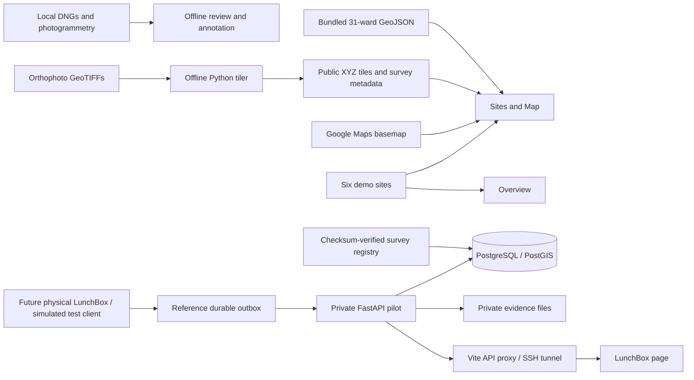

# IN-VBDM — project context

**Last reconciled:** 22 October 2026, Asia/Calcutta.  
**Project:** Intelligent Vector-Borne Disease Monitoring; UI name: Mosquito Risk Intelligence.  
**Location:** Nashik, Maharashtra, India; initial aerial survey at KBTCOE.  
**Purpose of this file:** current project orientation, architecture, evidence baseline and remaining work. Contribution instructions are in [AGENTS.md](AGENTS.md).

This snapshot is based on the local working tree, including ongoing uncommitted ward changes and the Git-ignored drone workspace. Deployment results below are attributed to existing operations records; the server was not contacted during this documentation review. See the [review coverage record](docs/REPOSITORY_REVIEW_2026-10-22.md) for what was inspected.

## 1. Purpose and current position

The project aims to connect aerial environmental evidence, LunchBox trap observations and field verification to one persistent surveillance-and-response workflow:

**Survey → identify a potential site → review evidence → assign field verification → record findings → plan and complete intervention → follow up and reassess.**

We currently have a working map/imagery frontend, a private backend/storage and LunchBox ingestion pilot, and a substantial local drone review/annotation workspace. The full operational evidence-to-action loop is not implemented.

The aerial and trap workstreams answer different questions. Drone imagery supports environmental feature review. LunchBox observations are intended to support mosquito counts/species predictions. Human field evidence establishes what was actually inspected or verified. None of these alone establishes disease transmission or an independently validated risk score.

## 2. What exists today

| Capability | Current state | Practical limit |
| --- | --- | --- |
| Overview `/` | Demo summary, attention queue and activity | Uses six static demo sites and some hard-coded values; no live operational analytics |
| Sites & Map `/sites` | Active Google Maps workspace with search, filters, list/detail selection and layers | Surveillance markers/statuses are demo; no create/edit/assign workflow |
| Ward boundaries | 31 Nashik ward polygons, visible by default and selectable by exact number | Owner-approved for project use; this integration did not independently certify municipal accuracy |
| Drone imagery | Real Areas A–D orthophotos rendered as 1,630 transparent XYZ tiles | Display readiness does not establish positional accuracy, complete selected-area coverage or detected mosquito sites |
| KBTCOE · LunchBox `/lunchbox` | Reads registered campus/survey inventory, devices and observations from the private API | Requires operator token and backend connection; records remain unreviewed; no real field observations recorded in the documented pilot |
| Persistent storage | FastAPI, PostgreSQL/PostGIS, evidence files and audit events | Shared operator access; no individual user accounts/roles or complete lifecycle |
| LunchBox ingestion | Device credentials, deployment history, validated/idempotent events, optional images, durable reference outbox | Tested with simulations; physical deployment, model integration and supervised device service remain pending |
| Drone annotation | Orthophoto release, raw identity adjudications, polygon drafts and detection candidate | Dataset review/quality restrictions remain; no training or assigned train/validation/test split |
| Field operations | Planned navigation and disabled workflow action | No task assignment, inspection/review, intervention or follow-up implementation |
| Production readiness | Private pilot plus documented manual backup/restore checks | Scheduled/off-server backups, monitoring, source-imagery backup and operational acceptance remain pending |

### Routes and user-visible behavior

- `/`: [OverviewPage.tsx](frontend/src/pages/OverviewPage.tsx), using [demoData.ts](frontend/src/data/demoData.ts).
- `/sites`: [SitesPage.tsx](frontend/src/pages/SitesPage.tsx). Search covers demo sites, seven approximate local destinations and loaded wards. It does not call Places/Geocoding. The `site` query parameter preserves site selection.
- `/lunchbox`: [LunchBoxPage.tsx](frontend/src/pages/LunchBoxPage.tsx). Refreshes every 30 seconds, displays the latest 100 observations, hides simulations by default, and retains the token only in component memory.
- Unknown routes redirect to `/`. Surveys, Field Operations, Reports and Administration are marked planned, not routed products.

## 3. Architecture and data flow



The local annotation workspace is not an inference service and does not populate map markers. The backend's site/evidence endpoints are not yet connected to Overview or Sites & Map. LunchBox observations are attached to devices/deployments/campus context; reviewed linkage into the persistent site lifecycle remains future work.

### Frontend

React 19, TypeScript 5.7, Vite 6 and React Router 7; npm manages dependencies. Google Maps uses the official JavaScript loader, advanced markers, a ward data-layer adapter and independent ground-image/XYZ survey adapters.

`frontend/src/geospatial/` holds contracts, validation, loading and adapters. `GoogleSurveillanceMap.tsx` owns the active map lifecycle. `LayersPanel.tsx` controls basemap, ward/hotspot/LunchBox visibility, drone master/area visibility and opacity. CSS is plain project CSS, with separate active map and LunchBox styles.

Legacy `DemoMap.tsx`, Leaflet `NashikMap.tsx`, MapLibre `NashikMapGL.tsx` and MapLibre dependencies remain. They are not imported by the active page. Removing them is a separate cleanup decision.

### Backend and storage

[backend/app.py](backend/app.py) provides health, sites, surveys and evidence upload/download. [backend/lunchbox.py](backend/lunchbox.py) adds campus reads, device provisioning/revocation, deployment history and observations/images. Base tables are in [schema.sql](backend/schema.sql); [migration 002](backend/migrations/002_campus_lunchbox.sql) adds campus/assets/LunchBox structures.

The database stores relational records and PostGIS locations. Image bytes live in a private evidence directory; records store generated storage keys, checksums and metadata. Registered drone assets reference existing source files rather than copying them into the evidence store. The generic evidence endpoint accepts validated JPEG/PNG/TIFF images up to 25 MiB; it is not a bulk survey importer. LunchBox supports one optional JPEG/PNG per observation.

The recorded Ubuntu deployment uses Docker Compose project `mosquito-storage-pilot`, separate from WebODM. PostgreSQL has no published host port; the API binds host loopback `127.0.0.1:8091`. Database files live beneath `/home/kbtcoe/mosquito-surveillance`; evidence/backups beneath `/data/Arsha_Project/mosquito-surveillance`. Exact operations and recovery steps are in [UBUNTU_STORAGE_PILOT.md](docs/UBUNTU_STORAGE_PILOT.md).

### LunchBox semantics that must remain explicit

- Operator and device credentials have distinct privileges; operator identity remains the shared `pilot-operator`, not an individual account.
- A device/event ID identifies an immutable observation. Exact retries are acknowledged; conflicting payloads are rejected. Optional image completion is acknowledged separately.
- `frame_count`, `interval_new` and `trap_total` have different meanings. Repeated frames/trap totals must not be summed as new individuals.
- A valid zero differs from capture/inference failure, which has a null count. Species predictions and confidence are supplied model outputs, not validated accuracy claims.
- Event times have timezone offsets; server receipt time is separate. Deployment intervals constrain event acceptance, including delayed uploads.
- The SQLite outbox is reference client code, not deployed firmware, a scheduler or a trained model. See [LUNCHBOX_INTEGRATION.md](docs/LUNCHBOX_INTEGRATION.md).

## 4. Real data and provenance

### Survey scope

The broader KBTCOE campus specification is **154,537.73 m²**. The owner clarified that this capture covered **four selected locations within it**, Areas A–D, rather than the entire campus. Capture date is **19 August 2026**. Exact capture timezone and selected-location acceptance boundaries remain unspecified in the current integration.

| Area | Original DNGs | Registered processed assets | Public map tiles |
| --- | ---: | ---: | ---: |
| A | 100 | 6 | 663 |
| B | 18 | 6 | 136 |
| C | 248 | 6 | 588 |
| D | 8 | 6 | 243 |
| Total | **374** | **24** | **1,630** |

Each processed set includes orthophoto, DSM, point cloud, GLB model, report and camera-position GeoJSON. The [registration manifest](deploy/ubuntu/kbtcoe-manifest.json) contains 398 assets; the October 21 integration record reports local/server checksum matching. This review checked inventory counts, not a fresh server checksum comparison.

Raw metadata contains 396 rows, including 22 for which no DNG is available in the four curated folders, as recorded by the raw-review inventory. Camera GPS is camera position, not automatically the location of a feature in the image.

Source orthophotos use EPSG:32643. Public tiles use a Web Mercator XYZ grid, zooms 14–22, 256×256 RGBA PNGs; the recorded total is approximately 144.5 MiB. WGS84 bounds and processing provenance are in [surveys.json](frontend/public/drone/surveys.json) and [processing-audit.json](frontend/public/drone/processing-audit.json). Native imagery remains outside `frontend/public/`.

Ground-control accuracy, selected-location coverage acceptance, report/export area differences, vertical reference and 3D placement require separate evidence. A successful map display or checksum match does not resolve them.

### Wards

[frontend/public/data/nashik_wards.geojson](frontend/public/data/nashik_wards.geojson) is the active 31-ward collection, with string IDs `1`–`31`. [WARD_BOUNDARIES.md](docs/WARD_BOUNDARIES.md) records owner verification/approval on October 22 and the owner's NMC PDF reference. That integration did not extract coordinates from the PDF or independently certify its correspondence.

The earlier manual Ward 7 trace is retained in [geojson/ward_07.geojson](geojson/ward_07.geojson) and [kml/Ward_No_7.kml](kml/Ward_No_7.kml). It is historical input, not the active public layer. Ward coverage does not imply citywide imagery, observations, risk estimates or automatic site-to-ward assignments.

## 5. Drone annotation workspace

`Drone_First_Flight/` is a significant local research workspace ignored by Git. A fresh repository clone will not contain it. Its [README](Drone_First_Flight/README.md) and [project_layout.json](Drone_First_Flight/project_layout.json) locate current artifacts; the layout changed on October 20.

### Stable taxonomy

Frozen rules define five classes: `visible_water`, `open_construction_pit_or_basin`, `storage_tank`, `open_container`, and `debris_accumulation`. Water and structure labels may overlap. Unknown/ignored regions are not a sixth class, and field breeding status remains unknown without field evidence.

### Distinct current artifacts

| Artifact | Location under `Drone_First_Flight/` | Recorded state |
| --- | --- | --- |
| Current orthophoto release | `datasets/releases/annotation_expansion_v1_1/` | 70 records: 44 accepted positives, 17 exclusions, 9 ignored regions; 39 class-specific physical examples; conservative eligible subset of 25 views / 22 examples |
| Raw-frame screening | `reviews/raw_frames/`, `reviews/raw_frame_plan/` | All 374 originals have recorded sparse screening across 20 packs; screening is not exhaustive pixel annotation |
| Current raw identity overlay | `reviews/raw_adjudication_v3/` | 70 target-identity records / 57 class-specific physical groups, 25 exclusions, 3 ignored regions; 43 quality-suitable source views; RC1003 and P012 share `C_roadside_pool` identity |
| View-selection and polygon-draft history | `datasets/work_in_progress/raw_annotation_v1/` | 36 primary plus 7 complementary feature views; 43 draft polygons; retains earlier selection/boundary-review provenance |
| Latest raw detection candidate | `datasets/releases/raw_detection_annotation_v1/` | 42 reviewed tiles from 27 original frames; default export contains 28 tiles (22 positive, 6 negatives), 23 boxes / 22 class-specific physical features; 12 held and 2 reserve tiles |

These counts refer to different stages and units and must not be added together. Earlier releases supply shared imagery/masks used by later releases.

The [latest detection report](Drone_First_Flight/datasets/releases/raw_detection_annotation_v1/Report.md) and its manifest explicitly record an **AI-reviewed candidate awaiting user dataset review**, with no human boundary acceptance recorded, no training authorized or performed, and no assigned split. Its default export contains only one physical visible-water feature and one physical pit feature. It cannot support a reliable independent five-class accuracy claim.

All views and derivatives of a physical feature/overlapping scene must stay in one split. Current conservative groups are `AC_shared_construction`, `B_site` and `D_site`. Sparse unmarked pixels remain unknown; any reviewed-background permission is limited to the candidate's exact eligible tile boundaries and review status.

## 6. Where every part of the workspace belongs

On 22 October 2026, the frontend source, assets, tests, configuration, private local environment and generated frontend folders moved together into `frontend/`. The backend, shared tools, historical GIS inputs and drone workspace remain at the repository root. Browser routes and static asset URLs are unchanged. The processing audit source paths remain relative to the repository root.

Fresh validation after this move: typecheck, lint, production build and all 28 normal regressions passed from `frontend/`; all 1,630 tiles were preserved. Regression servers now use separate Vite dependency caches after a Windows cache collision on the first run. See the [dated checkpoint](docs/IMPLEMENTATION_CHECKPOINTS.md#frontend-directory-reorganization--22-october-2026) for checks and limits. Live services were not rechecked.

| Path | Role and handling |
| --- | --- |
| `frontend/src/` | Active application entry, routes, pages, components, demo data, domain types, geospatial adapters, CSS and vendor/Vite declarations |
| `backend/` | FastAPI app, LunchBox router, base SQL, additive migrations, Dockerfile and dependency specifications; `__pycache__` is generated |
| `deploy/ubuntu/` | Compose, bootstrap/init/migration, asset manifest preparation/registration, smoke checks, backup and isolated restore scripts |
| `tools/` | Offline map tiler, durable LunchBox outbox and explicit live LunchBox browser check |
| `frontend/tests/` | UI, GIS, wards, drone and mocked LunchBox regressions plus two live-map test files; historical `ward7` filenames now also cover the 31-ward collection |
| `frontend/public/data/` | Active browser-served ward GeoJSON |
| `frontend/public/drone/` | Survey metadata, processing audit and `area-{a,b,c,d}/{z}/{x}/{y}.png` tiles |
| `geojson/`, `kml/` | Historical manual Ward 7 inputs used for provenance and compatibility tests |
| `docs/` | Specialist guides, roadmap and historical design/handoff/checkpoint records |
| `Drone_First_Flight/data/` | `raw_dng/`, `photogrammetry/` and `metadata/`; original scientific inputs |
| `Drone_First_Flight/datasets/` | Versioned `releases/` and `work_in_progress/`; annotations, masks, exports, review HTML and co-located builder/verifier scripts |
| `Drone_First_Flight/reviews/` | `orthophoto/`, `raw_frames/`, `raw_frame_plan/`, `raw_adjudication_v1/`, `v2/`, `v3/`; evidence and evolving review decisions |
| `Drone_First_Flight/docs/taxonomy/` | Class definitions, frozen annotation rules and machine-readable schemas |
| `Drone_First_Flight/tooling/` | Layout migration/integrity utilities and local Windows Python dependency bundles under `environment/` |
| `Drone_First_Flight/archive/` | October 20 restructuring inventory, original-text archive, move map and audit reports |
| `frontend/dist/` | Generated frontend build, including copied public imagery; do not edit as source |
| `frontend/node_modules/` | Installed third-party dependencies; use the npm manifest/lockfile |
| `frontend/test-results/` | Generated browser check artifacts and last-run metadata; presence alone is not proof of current success |
| `tmp/` | Local deployment archives, image QA previews and temporary review/check outputs; not canonical source |
| `.git/` | Existing version-control internals; do not edit directly |
| Frontend configuration (`frontend/`) | `package.json`/lockfile, Vite, TypeScript, ESLint and Playwright configs, `index.html`, `.env.example`; root `.gitignore` covers the whole repository; `.env.local` is private local configuration and `.tsbuildinfo` is generated |

## 7. Development and verification

From the repository root:

```sh
cd frontend
npm ci
npm run dev
```

For the map, copy `frontend/.env.example` to `frontend/.env.local` only if a local file does not already exist, configure the browser map key/map ID privately, and restart Vite. Missing configuration produces an explicit state; records remain accessible. Optional ward/survey URLs replace the bundled collections. See [Google Maps setup](docs/GOOGLE_MAPS_SETUP.md).

For `/lunchbox`, the documented Windows connection is `ssh -N -L 8091:127.0.0.1:8091 kbt-server`. Vite dev/preview proxies `/api` to that loopback port and strips the prefix. The page accepts the operator token privately. A deployed static build needs its own private authenticated backend routing; Vite's development proxy is not a production reverse proxy.

Run frontend checks from `frontend/`; deployment and drone commands retain their separately documented working directories.

| Check | Command / scope |
| --- | --- |
| TypeScript | `npm run typecheck` |
| Lint | `npm run lint` |
| Production bundle | `npm run build` |
| Normal regressions | `npm test`; ports 5187/5188; no real backend, live map or real observation writes |
| Live Google display | `npm test -- --config playwright.live.config.ts`; port 5189 and real map key/network |
| Live LunchBox UI | From the repository root: `node tools/check-lunchbox-live.mjs`; SSH/backend access and ports 8091/5190 |
| Backend validation | Server smoke scripts, with `--verify-only` for retained-record inspection; full runs write simulations |
| Drone integrity | Consult `Drone_First_Flight/tooling/README.md`; bundled dataset checks require Python 3.12, while selected standard-library checks have different requirements |

Recorded validation progressed from 25 normal and 2 live map tests on October 12, to 26 frontend tests plus backend/restore checks on October 21. The October 22 ward checkpoint records **28 normal tests, 2 live map tests and a passing build**, followed by passing targeted ward checks after a numeric-alias adjustment. These are results recorded by those implementation tasks, not tests rerun for this documentation change or a fixed future suite size. Current test discovery comes from the installed Playwright configuration.

For documentation-only changes, validate local links, source/manifests, command paths and diffs. Do not rerun external integrations, source reprocessing or training just to refresh a context document.

## 8. Remaining work and recommended sequence

The next application milestone is **one real site created or matched from aerial evidence, persisted and sent through manual field verification**. Extend the existing backend and survey registry to do this.

1. Reconcile canonical entities, lifecycle, evidence definitions, user roles and review permissions. The UI has ten demo statuses, base SQL currently permits only `Potential`, and the roadmap proposes 17 states. E0–E4 are UI labels, not an implemented evidence standard.
2. Add individual authentication/authorization, real site/evidence intake and a chronological evidence/review view. Connect Overview and Sites & Map to real reads while retaining an explicit demonstration mode.
3. Add assignment, mobile observation capture and reviewed verified/inconclusive outcomes, retaining retries and history.
4. Add intervention planning/completion, follow-up scheduling and baseline comparisons with traceable reporting.
5. Continue annotation review independently: resolve held boundary/context cases, retain explicit quality exclusions, and obtain more independent examples before selecting an evaluation/training plan.
6. Provision and validate actual LunchBox hardware, measured locations, model/count contract, secure connectivity, clock behavior and supervised outbox retries. Ingestion code is already present; real deployment and review integration remain.
7. Generalize survey ingestion, verify GIS fitness for intended operational use, and establish source-imagery backups, scheduled external backups, monitoring and pilot acceptance.

Manual observations can prove the operational workflow before hardware or validated AI is available. No model, new provider or deployment change is selected by this document. See [SYSTEM_ROADMAP_AND_STATUS.md](docs/SYSTEM_ROADMAP_AND_STATUS.md) for completion gates.

## 9. Documentation map and authority

| Document | Use |
| --- | --- |
| [AGENTS.md](AGENTS.md) | Working conventions, preservation rules and validation scope |
| [README.md](README.md) | Quick setup and entry points |
| [SYSTEM_ROADMAP_AND_STATUS.md](docs/SYSTEM_ROADMAP_AND_STATUS.md) | Current milestone status, target workflow and acceptance gates |
| [LUNCHBOX_INTEGRATION.md](docs/LUNCHBOX_INTEGRATION.md) | Device/event contract, private access, registry and outbox semantics |
| [UBUNTU_STORAGE_PILOT.md](docs/UBUNTU_STORAGE_PILOT.md) | Recorded deployment, credentials handling, backup/restore and operations |
| [WARD_BOUNDARIES.md](docs/WARD_BOUNDARIES.md) | Active ward dataset, owner approval, replacement history and validation limits |
| [DRONE_MAP.md](docs/DRONE_MAP.md), [GEOSPATIAL_INTEGRATION.md](docs/GEOSPATIAL_INTEGRATION.md) | Processing, metadata contracts, map delivery and accuracy limits |
| [GOOGLE_MAPS_SETUP.md](docs/GOOGLE_MAPS_SETUP.md) | Frontend map configuration |
| [Drone README](Drone_First_Flight/README.md), [layout pointers](Drone_First_Flight/project_layout.json) | Current local review/release entry points; available only where the ignored workspace exists |
| [IMPLEMENTATION_CHECKPOINTS.md](docs/IMPLEMENTATION_CHECKPOINTS.md) | Historical migration and dated executed checks |
| [UI/UX design specification](docs/IN-VBDM_Dashboard_UI_UX_Design_Specification.md) | Historical design intent and useful workflow/accessibility requirements; original MapLibre/lifecycle choices are not the current implementation |
| [Context handoff v4](docs/Mosquito_Surveillance_Project_Context_Handoff_v4.md) | Historical project, capture-scope and hardware-proposal background as of October 11 |
| [Repository review](docs/REPOSITORY_REVIEW_2026-10-22.md) | Inventory methodology, review coverage and limits for this reconciliation |

For current behavior, inspect source and current configuration. For dataset status, read the relevant versioned manifest and latest explicit adjudication. For deployment claims, use dated operations evidence and recheck live state when the task depends on it. If sources disagree, preserve the discrepancy until resolved; an older design or report must not silently override newer implementation or owner decisions.

Update this file and affected specialist guides when current scope, source locations, release pointers or milestones change. Keep historical checkpoints dated and record only validation actually performed.
