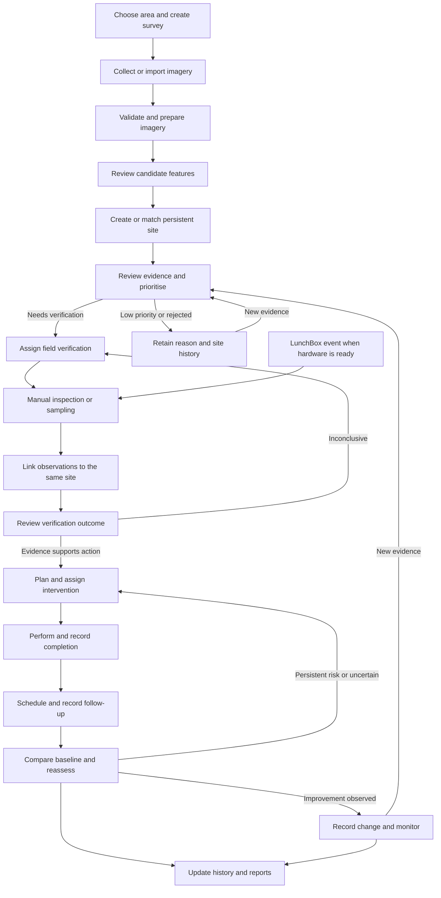

# End-to-end mosquito surveillance system: flow, roadmap and status

Last reconciled: **22 October 2026 (Asia/Calcutta)** against the local working tree and current manifests. The original workflow comparison was made on 12 October; dated validation records remain historical. This is a manually maintained tracker. Read [PROJECT_CONTEXT.md](../PROJECT_CONTEXT.md) for the architecture/data overview and [AGENTS.md](../AGENTS.md) for contribution instructions.

**Current scope:** Google map and real imagery, 31 owner-approved ward boundaries, six demo surveillance sites, a private FastAPI/PostgreSQL/PostGIS storage and LunchBox pilot, and a local drone annotation workspace. The full field-verification/intervention/follow-up loop remains incomplete.

**Recorded 21 October deployment:** KBTCOE's 19 August survey is registered with 398 checksum-matched assets; device credentials, deployments, idempotent observations, optional images and a reference outbox exist. `/lunchbox` reads the backend. This documentation review did not contact the server again. See [storage operations](UBUNTU_STORAGE_PILOT.md) and [LunchBox integration](LUNCHBOX_INTEGRATION.md).

**22 October local state:** the active boundary collection contains all 31 wards; current drone artifacts include an AI-reviewed raw detection candidate awaiting user review, with no model training or assigned split. Current-state sections and milestone statuses below supersede the earlier backend-absent baseline.

## 1. Complete step-by-step project flow

The intended system follows one physical site through repeated surveys, observations, decisions, interventions and follow-up. New evidence attaches to the same persistent Site ID wherever it concerns the same location. A survey, detection, trap event and site are different records.

| Step | User/system action | Result to retain | Important branch or condition |
| --- | --- | --- | --- |
| 1 | Health officer selects a ward or survey area. | Area geometry, boundary source/version, responsible officer. | A survey can cover a subset of a ward or extend beyond it; do not silently clip imagery or invent ward assignments. |
| 2 | Create a survey and define its boundary, purpose and planned dates. | Persistent Survey ID, boundary, ownership and capture metadata. | Repeat surveys get new IDs while retaining links to the same area and sites. |
| 3 | Collect drone imagery or import existing photogrammetry outputs. | Original images/orthophoto, reports and provenance. | Existing WebODM outputs are a valid starting point; flight automation is not required for the first operational loop. |
| 4 | Validate and prepare geospatial assets outside the browser. | Verified CRS, bounds/footprint, capture date, processing audit, browser imagery tiles. | Reject unsupported/malformed input; keep processing errors visible. Display readiness does not prove positional accuracy. |
| 5 | Review aerial imagery and identify environmental candidates, manually at first or with validated AI later. | Candidate geometry, evidence crop/reference, classification, reviewer and optional model/version/confidence. | A suspected water-holding feature does not establish larvae, species or disease risk. |
| 6 | Create a potential site or link the candidate to an existing site. | Stable Site ID plus a new evidence record linked to its survey. | Check nearby existing sites and coordinate uncertainty; avoid duplicating a site on each flight. |
| 7 | Display the site and its evidence on the map; health officer reviews and prioritises it. | Review outcome, priority reason, next action and immutable history. | Send for verification, retain as LowPriority with a reason, or Reject with a reason. New evidence may reopen review. |
| 8 | Create a field verification task and assign a field worker. | Task ID, Site ID, assignee, due date, instructions and task history. | Inconclusive evidence can create another inspection/sampling task without deleting earlier attempts. |
| 9 | Record a ground observation. | Inspection/sampling/trap observation with time, location quality, author, attachments and source. | Initially use real manual observations or clearly labelled samples. When hardware is ready, import LunchBox events through a separate adapter; retain validated image/AI results when available. |
| 10 | Link ground evidence to the same Site ID and review aerial plus ground evidence. | Evidence timeline and explicit verification outcome. | Inconclusive means repeat inspection/sampling; supported evidence can lead to intervention. Recording evidence alone must not automatically mean Verified. |
| 11 | Health officer chooses and assigns an appropriate intervention. | Intervention ID, Site ID, approved action, responsible team and planned date. | Selection and approval belong to the authorised operational process; model confidence alone must not select an action. |
| 12 | Team performs the intervention and records completion evidence. | Start/completion timestamps, actual action, completion evidence and any failure/partial result. | A planned/assigned action is not a completed action; retain discrepancies and reasons. |
| 13 | Schedule follow-up surveillance and record the next observation. | Follow-up task/date and evidence linked to the site and intervention baseline. | Due dates must drive a real queue; a display label alone is insufficient. |
| 14 | Compare follow-up with the baseline and reassess. | Comparable measures, assessment, uncertainty and limitations. | Improvement leads to Monitoring; persistent risk/uncertainty leads to NeedsFurtherAction and another plan. |
| 15 | Update site history, ward/area summaries and officer priorities. | Traceable reports and queues derived from stored records. | Preserve low-priority/rejected sites and historical evidence. New evidence can restart review. |

This flow expresses the supplied process diagram. It describes the target; most operational actions are not yet implemented.

## 2. Where we are now

**We have a map/imagery foundation, persistent storage and LunchBox ingestion foundations, and offline annotation artifacts. We do not yet have a complete persistent evidence-to-action system.**

The next missing application connection is **review imagery → create or match a real site → retain linked evidence → assign and review field verification**. The demo markers were not extracted from Areas A–D and are not the local annotation records.

The backend exists under `backend/`, with PostgreSQL/PostGIS and evidence storage configured under `deploy/ubuntu/`. Overview and Sites & Map still import demo records. `/lunchbox` is the implemented backend read integration. The base site schema permits only `Potential`; no operational transition API exists. The UI status union and the proposed lifecycle below still need reconciliation.

Status vocabulary:

- **Implemented (scoped):** capability exists within the stated limits.
- **Partial:** supporting components exist but the completion gate is unmet.
- **Demo:** illustrative records/UI; no real operational outcome established.
- **Not implemented / Not started:** no executable workflow found in this workspace; design text may already exist.
- **External validation/input needed:** code or local records cannot establish the claim alone.

### Architecture coverage

| Capability | Current status | Evidence and remaining limit |
| --- | --- | --- |
| Original survey sources | Implemented (scoped) | `Drone_First_Flight/data/` contains 374 DNGs, metadata and four photogrammetry sets. Independent positional/coverage acceptance remains separate. |
| GIS preparation/display | Implemented (scoped) | Offline tiler, WGS84 metadata and 1,630 public XYZ PNGs; no repeatable multi-survey import/job service. |
| Ward layer | Implemented (scoped) | All 31 wards at `frontend/public/data/nashik_wards.geojson`; owner approval/provenance in `WARD_BOUNDARIES.md`. |
| Survey registry | Partial | One campus/survey, four areas and 398 registered original/processed assets; no general bulk importer or browser survey management. |
| Site/evidence persistence | Partial | Backend site/survey/evidence endpoints, files/checksums and audit events exist; map intake, matching, evidence timeline and review remain missing. |
| Map surveillance records | Demo | Six `demoSites`; Overview metrics/activity and Sites detail are not live operational feeds. |
| LunchBox ingestion | Partial | Device credentials, deployment history, immutable/idempotent observations, images and SQLite outbox implemented; real hardware/network/service/model deployment pending. |
| LunchBox dashboard | Implemented (scoped) | `/lunchbox` reads campus/devices/latest observations with explicit test filtering; shared private operator access. |
| Aerial annotation | Partial | Versioned orthophoto labels, raw identity adjudications and a raw detection candidate; current candidate awaits user review. |
| Validated AI inference | Not implemented | No trained/validated model, operational inference service or reviewed model-to-site adapter. Annotation exports do not establish these. |
| Manual observation/field verification | Not implemented | No assignment, inspection form, reviewer decision or verified/inconclusive transition workflow. |
| Intervention/follow-up | Not implemented | UI labels are demos; no execution records, due queues, comparable reassessment or outcome reporting. |
| User identity/permissions | Partial | Shared operator token and isolated device credentials; no individual officer/worker accounts or role system. |
| Recovery/operations | Partial | Recorded manual coordinated backup and isolated restore; scheduled/off-server backup, source-imagery backup and monitoring pending. |
| Version control | Implemented (scoped) | `.git/`, npm/backend lockfiles and ignore rules exist; the raw drone workspace is local and Git-ignored. |

### Real data and annotation baseline

| Asset | Established by local files/recorded evidence | Not established |
| --- | --- | --- |
| Areas A–D imagery | Capture date 19 August 2026; source EPSG:32643; four ready XYZ layers at zooms 14–22; 1,630 RGBA 256px tiles | Current live surveillance, ground-control accuracy, complete selected-location coverage or whole-campus capture |
| KBTCOE registration | Manifest contains 374 raw and 24 processed assets; October 21 record reports server checksum matching | General asset ingestion/delivery, source-imagery backup or a new server availability check today |
| Wards 1–31 | Owner-approved collection with preserved geometry; previous manual Ward 7 retained under `geojson/` and `kml/` | Independent municipal certification, gap/overlap-free partition, automatic site assignment or ward-level risk |
| Orthophoto annotation release | `annotation_expansion_v1_1`: 70 records, 44 accepted positives, 39 class-specific physical examples | Exhaustive pixel/background labels, reliable model generalization or training authorization |
| Raw identity overlay | Adjudication v3: 70 target identities / 57 class-specific groups, with preserved quality restrictions | Human acceptance of every derived boundary or independent site count across classes |
| Raw detection candidate | 42 reviewed tiles; 28 default export tiles, 23 boxes / 22 class-specific features; 12 held and 2 reserve | User dataset approval, human boundary acceptance, training or an independent five-class evaluation |
| LunchBox ground observations | Ingestion and simulated tests recorded; real field observations absent in the documented pilot | Physical deployment, validated species classifier or ground verification |

The latest detection candidate contains only one physical water feature and one physical pit feature in its default export. Keep all A/C overlapping scenes grouped, retain quality/coverage holds, and consult [the current report](../Drone_First_Flight/datasets/releases/raw_detection_annotation_v1/Report.md) before planning training. See [project context](../PROJECT_CONTEXT.md) for current paths and artifact distinctions.

## 3. Required lifecycle implementation (diagram 3)

The diagram names **17 states**. The current `SiteStatus` union in `frontend/src/domain.ts` uses a smaller, different vocabulary. Reconcile that vocabulary before wiring operations. The following transitions transcribe the diagram; guards and permissions are proposed implementation requirements, not existing functionality.

| From | To | Required action/guard |
| --- | --- | --- |
| New site | Potential | Create a persistent site with source evidence and provenance. |
| Potential | UnderReview | Start an officer review. |
| UnderReview | NeedsVerification, LowPriority or Rejected | Record decision, reason and reviewer. |
| LowPriority, Rejected or Monitoring | UnderReview | Attach new evidence and initiate another review; keep the earlier decision. |
| NeedsVerification | VerificationAssigned | Create a verification task with assignee and due date. |
| VerificationAssigned | AwaitingObservation | Task is ready for field evidence; do not infer that a visit occurred. |
| AwaitingObservation | EvidenceRecorded | Save a valid inspection/trap/sampling observation linked to this site. |
| EvidenceRecorded | Verified or Inconclusive | Authorised reviewer evaluates evidence and records the outcome. |
| Inconclusive | VerificationAssigned or UnderReview | Repeat inspection/sampling or reconsider the case, retaining the reason. |
| Verified | InterventionPlanned | Authorised officer records a justified intervention plan. |
| InterventionPlanned | InterventionInProgress | Responsible team records work starting. |
| InterventionInProgress | InterventionCompleted | Record completion and evidence; handle incomplete/failed work explicitly. |
| InterventionCompleted | FollowUpDue | Create follow-up schedule/task. |
| FollowUpDue | Reassessed | Save follow-up observation and baseline comparison. |
| Reassessed | Monitoring or NeedsFurtherAction | Record observed change, uncertainty and assessment. |
| NeedsFurtherAction | InterventionPlanned | Create the next intervention cycle without overwriting the previous one. |

Current labels needing reconciliation:

| Current code label | Target interpretation to decide |
| --- | --- |
| Detected | Likely Potential; distinguish machine detection from a reviewed site. |
| Awaiting Verification | Currently conflates NeedsVerification, VerificationAssigned and AwaitingObservation. |
| Verified | Shared name; needs evidence/reviewer guards. |
| Intervention Assigned | Assignment is a task property; decide how it relates to InterventionPlanned/InProgress. |
| Intervention Completed / Follow-up Due / Reassessed | Shared concepts, but currently demo labels without transition history. |
| Unable to Verify | Likely an Inconclusive observation/task outcome; retain the specific reason. |
| No Longer Actionable | Decide whether LowPriority, Rejected or Monitoring applies; these are not interchangeable. |
| Reopened | Prefer an audited return to UnderReview with new evidence unless an additional state is justified. |

Implement canonical states and transition validation in the backend, with readable frontend labels. Store each transition's actor, timestamp, reason and related evidence/task IDs. Reject invalid and unauthorised transitions, and prevent stale concurrent updates. Site lifecycle, task status, priority, evidence quality and survey processing status are separate concepts; one field should not represent all of them. Multiple tasks/interventions may require deriving the site's overall state from their records under explicit rules.

## 4. Steps needed to reach the complete system

These milestones are in dependency order. Their current statuses reflect the scoped implementation described above; completion gates describe what is required to finish each milestone.

| ID | Milestone | Current status | Completion gate |
| --- | --- | --- | --- |
| M0 | Map and imagery foundation | Implemented (scoped) | Supplied imagery and ward display, controls and regression checks. Accuracy/authority validation remains separate. |
| M1 | Agree on operational/domain contracts | Partial definitions; agreement pending | Canonical lifecycle, roles, entities, evidence definitions, matching rules and API contracts documented and reviewed. |
| M2 | Persistent backend and storage | Partial — private storage pilot exists | Real sites, surveys, evidence and history survive reloads; authentication/permissions, uploads and restore path work. |
| M3 | Real site and evidence intake | Partial — registry/API foundations; map intake missing | Officer creates/matches a site from imagery; survey/evidence linkage and provenance appear in a real timeline. |
| M4 | Manual field verification | Not started | Assign → inspect/sample → upload → review → verified/inconclusive loop works with real records. |
| M5 | Intervention execution | Not started | Authorised plan, assignment, start, completion and evidence stored with valid transitions. |
| M6 | Follow-up, comparisons and reports | Not started | Due queue, follow-up evidence, baseline comparison, reassessment branches and source-traceable reports work. |
| M7 | Repeatable survey ingestion and production GIS validation | Partial | Versioned imports/jobs handle later surveys safely; coverage/provenance and operational accuracy requirements are validated. |
| M8 | LunchBox integration | Partial — ingestion/UI/outbox; real deployment pending | Real devices/events imported reliably; observations matched to sites with provenance and review. |
| M9 | Validated aerial/ground AI adapters | Partial data preparation; validated inference missing | Evaluated model outputs enter review as machine evidence, with versions, confidence and correction history. |
| M10 | Operational pilot and production readiness | Partial infrastructure; operational acceptance missing | Approved pilot cases, access isolation, recovery, monitoring, data-quality checks and deployment verified. |

M7–M9 can progress independently once the shared contracts exist. **LunchBox and AI are not prerequisites for M3–M6:** the supplied process explicitly supports a manual/sample observation route. Clearly labelled samples support demonstrations; real observations and operational review are required to claim a real pilot.

### M1 — Define records and decisions

1. Define Ward/Area, Survey, SurveyAsset, Site, Evidence/Observation, Review, VerificationTask, Intervention, FollowUp/Assessment, Device/Event and AuditEvent records.
2. Separate permanent Site ID from Survey ID, detection ID, device ID and observation ID. Establish how nearby candidates are matched, merged or split while keeping traceability.
3. Agree on the 17 lifecycle states, authorised transitions and how parallel tasks affect site status. Define priority rationale separately.
4. Define inspection/sampling/trap observations, negative findings, inaccessible locations and missing/unknown values. Document what E0–E4 mean before operational use; the current union does not provide an evidence standard.
5. Specify API reads/writes, attachment ownership, timestamps, validation errors, idempotency keys and optimistic concurrency. Build on the existing FastAPI/PostgreSQL/PostGIS and private evidence-file pilot; document any deliberate architecture change.

### M2 — Build the backend and persistent storage

1. Extend the existing server/API and migrations with spatial candidate/site matching and the agreed domain contracts.
2. Add individual officer/field-worker authentication and server-side permissions while preserving existing operator/device credential separation.
3. Extend existing site/survey/evidence reads and writes, stable IDs and audit history with reviewed evidence and transition validation.
4. Store raw imagery/attachments separately from relational records, with file validation, provenance, access control and versioned references. Current files in `public` are served as static public assets.
5. Replace `demoSites` imports on Overview and SitesPage with real queries; keep demos in an explicitly separated mode and derive summaries from real data.
6. Verify reload persistence, duplicate submission handling, concurrent edits, permission failures and a database/file restore procedure.

### M3 — Connect aerial evidence to real sites

1. Build on the registered KBTCOE survey and 398 asset references; generalize intake and retain capture and processing dates separately.
2. Add a manual candidate workflow on the imagery: select location/geometry, attach evidence, record environmental classification and coordinate uncertainty.
3. Suggest existing nearby sites for review before creating a new Site ID; record why evidence was linked or a new site created.
4. Add real site details, attachments and chronological evidence/review history. Add officer decisions and priority reasons.
5. Verify a candidate is traceable from site → observation/evidence → survey → original asset and that it survives reloads.

### M4 — Complete the manual verification loop

1. Add assignment and field-worker queues with due dates, visit guidance and controlled reassignment.
2. Add mobile inspection/sampling forms with time, coordinates/quality, findings, notes and attachments. Capture negative/inconclusive results explicitly.
3. Save observations to the same Site ID; reviewer records Verified or Inconclusive with reasons.
4. Implement retry visits and preserve every attempt. Decide whether offline capture is required; if so, add explicit pending/synced/conflict states and safe retries.
5. Exercise both successful verification and inaccessible/inconclusive cases using persisted data and distinct officer/worker accounts.

### M5–M6 — Close the action and outcome loop

1. Add officer-approved intervention plans and responsible-team assignment, then start/completion records and evidence.
2. Create follow-up schedules/tasks on completion, with due/overdue queues and clear ownership.
3. Record repeat observations against a specified pre-intervention baseline. Compare like-for-like measures and preserve effort, timing, weather/context and uncertainty where relevant.
4. Implement Reassessed → Monitoring and Reassessed → NeedsFurtherAction → new plan; keep multiple cycles.
5. Generate reports from stored sites, observations, interventions and assessments, with date ranges, coverage, provenance and incomplete-data indicators.
6. Validate one full persisted loop and one persistent-risk loop. An observed improvement is not, by itself, proof that the intervention caused it.

### M7–M9 — Extend input sources reliably

1. Generalise the current batch tiler into versioned survey intake with job status, validation, failure/retry handling and atomic publication of ready metadata.
2. Validate ward sources and imagery positioning for intended operational precision; keep original data and processing audits.
3. Apply the existing LunchBox device/deployment/event contract to real hardware; validate measured location, clock synchronization, capture/count semantics, connectivity and supervised retry service. Do not assume a trap represents the whole ward or a single breeding location.
4. Preserve implemented authenticated ingestion and exact-retry deduplication; add explicit reviewed linkage to sites and retain unmatched events for resolution.
5. Continue review of existing labels/detection exports, expand independent data and agree evaluation criteria before model training. Retain model/version, source image, coordinates, confidence and reviewer corrections; keep environmental detections separate from ground mosquito/species evidence.
6. Check error cases and data completeness before connecting model outputs to operational priorities.

### M10 — Verify the complete pilot

1. Deploy frontend, API, database and storage with environment-specific settings, key restrictions, HTTPS, observable errors and operational ownership.
2. Verify access boundaries, file visibility, backup/restore, failed imports, interrupted uploads, retries, concurrent assignments and scheduled follow-up behaviour.
3. Test new evidence reopening LowPriority/Rejected/Monitoring sites and repeat surveys attaching to existing sites.
4. Conduct a real pilot with accountable officers/workers and approved data-quality criteria. Include negative and inconclusive cases, not only successful ones.
5. Record acceptance evidence and remaining limits before claiming end-to-end operational readiness.

## 5. Things to take care of throughout

- **Evidence honesty:** keep demo, sample, machine, reviewed aerial and verified ground evidence distinguishable. A “Verified” demo label is not verification of this survey. Confidence is not probability of disease or proof of a breeding site.
- **Geometry and accuracy:** geographic browser coordinates are WGS84; GeoJSON uses longitude then latitude. Source orthophotos are EPSG:32643; XYZ imagery uses Web Mercator. Current `SurveyLayer.sourceCrs` validation is restricted to EPSG:32643; supporting other CRSs requires a deliberate processing/contract change. Structural checks and attractive map alignment do not establish survey accuracy.
- **Coverage:** all 31 ward boundaries are bundled, but only Areas A–D have drone imagery. These do not establish citywide surveillance. Demo area labels are not ward IDs; gaps/transparent pixels are not negative findings.
- **Identity and history:** never regenerate site identity per survey or overwrite baseline evidence with follow-up. Retain rejected/low-priority decisions, reviewer corrections, duplicate resolution and original event IDs.
- **Time:** retain capture/observed, imported, reviewed, updated, completed and follow-up times separately. Store timezone-aware timestamps and show local time clearly; current demo observation strings need migration to a defined format.
- **Permissions and files:** enforce roles on the server; frontend disabled buttons are not security. Review sensitive imagery and attachment access before putting it under static `public` paths. Keep secrets out of client bundles and documentation; browser map configuration needs appropriate restrictions.
- **Resilience:** validate uploads/geometry/metadata; expose incomplete and failed states, avoid duplicate writes on retries, and keep offline/concurrent edits from silently losing evidence.
- **Deployment size:** the current tile set is about 144.5 MiB according to the processing audit. Ensure deployment includes those assets or serves versioned tiles elsewhere; publish complete metadata/tiles together. Plan storage and request costs as surveys accumulate.
- **Comparisons and reporting:** define denominators, observation effort, baseline choice and missing coverage; avoid presenting demo counts or absent observations as measured risk/outcomes.
- **Maintainability:** this directory has a Git repository and ignore rules for credentials, raw bulk assets and generated outputs. Preserve unrelated working-tree changes. The Git-ignored drone workspace needs separate availability/backup planning. Legacy map components remain in source but the active page uses Google; assess cleanup as a separate implementation task.

## 6. Current tracker and next actions

Repository organization, 22 October 2026: the frontend now lives in `frontend/`, including npm/tool configuration, assets and browser tests. Run frontend commands there. Backend/deployment/shared tooling and the drone workspace remain at the root. This changes source locations, not milestone completion or deployed services.

The reorganization passed fresh typecheck, lint, build and all 28 normal regression tests from `frontend/`. A Windows Vite cache collision on the first run was resolved by separating the regression-server caches. See the [dated checkpoint](IMPLEMENTATION_CHECKPOINTS.md#frontend-directory-reorganization--22-october-2026); live integrations were not rerun.

### Completed within the current scope

- [x] React/TypeScript frontend with Overview, Sites & Map and KBTCOE · LunchBox routes.
- [x] Active Google map with Streets/Satellite, search, filters, list/detail selection and URL-backed site selection.
- [x] All 31 owner-approved ward boundaries loaded and selectable, with exact numbered searches and layer visibility controls.
- [x] Four supplied orthophotos prepared into 1,630 browser tiles with metadata and processing audit.
- [x] Drone master/per-area visibility, opacity, coverage fitting and survey details.
- [x] Existing regression tests for UI, GIS adapters, metadata, errors, LunchBox access and responsive layouts.
- [x] Private FastAPI/PostgreSQL/PostGIS and evidence-file pilot with recorded backup/restore checks.
- [x] Registered KBTCOE first survey, four areas and 398 checksum-verified asset references.
- [x] Device-scoped LunchBox ingestion, image acknowledgements and durable reference outbox tested with simulations.
- [x] Versioned orthophoto/raw review artifacts and a raw detection candidate prepared for user review; no training performed.

### Next implementation checkpoint

**Complete the missing parts of M1–M3: agree operational contracts and connect the existing backend/registry to one real site created or matched from imagery, with linked evidence.** Follow with M4 so that evidence can be checked in the field. Dataset review and hardware validation can continue independently; map polish alone will not close this operational gap.

- [ ] Agree canonical lifecycle/roles and evidence definitions.
- [x] Establish private backend, database and evidence-image storage foundations.
- [ ] Add individual user permissions and complete operational storage contracts.
- [x] Register the supplied KBTCOE first-survey assets.
- [ ] Create/match a real site from imagery with linked aerial evidence and review history.
- [ ] Replace demo feeds with persisted site reads and history.
- [ ] Assign a verification task to a field worker.
- [ ] Record/review a manual observation on the same Site ID.
- [ ] Exercise an inconclusive/retry branch.
- [ ] Plan/assign/complete an intervention with evidence.
- [ ] Schedule/record follow-up, compare with baseline and reassess.
- [ ] Produce a report traceable to stored records.
- [ ] Validate operational GIS fitness/accuracy and any authority requirements beyond recorded owner approval.
- [x] Implement LunchBox ingestion and test with explicitly simulated records.
- [ ] Deploy/validate a physical device and connect observations to reviewed operational records.
- [ ] Add AI inference only after evaluation and reviewed-evidence contracts exist.
- [ ] Complete production/pilot acceptance checks.

### Change log

| Date | Checkpoint | Evidence | Remaining gap |
| --- | --- | --- | --- |
| 11 Oct 2026 | Ward 7 display integration (previously recorded) | `IMPLEMENTATION_CHECKPOINTS.md`: supplied geometry preserved; live display/interaction check recorded. | Municipal authority and delimitation accuracy unverified. |
| 22 Oct 2026 | All 31 ward boundaries integrated | Owner-approved collection, [NMC PDF reference](WARD_BOUNDARIES.md), exact ward search, default visible layer; 28 automated tests and 2 live tests passed. | Owner reference verification is separate from independent municipal certification; site assignments remain separate. |
| 12 Oct 2026 | Areas A–D overlay integration (previously recorded) | `DRONE_MAP.md`, metadata/audit and current 1,630 tile files; previous checkpoint records 25 regression tests and 2 live tests passing. | Imagery viewing does not create observations/sites or verify positional accuracy. |
| 12 Oct 2026 | End-to-end status audit and roadmap added | Source inspection against all three supplied diagrams. | At that checkpoint, M1–M6 operational loop missing; M7 partial; M8–M10 missing. |
| 21 Oct 2026 | Private storage and KBTCOE/LunchBox integration | Operations guide records persistence, 398 matched assets, simulated ingestion, outbox and isolated restore checks. | Individual accounts, real devices, live site-map integration and operational workflows pending. |
| 22 Oct 2026 | All-ward layer and project-context reconciliation | Active 31-ward collection, owner provenance record, full local filesystem inventory and current release/source inspection. | Documentation review does not revalidate live services, source accuracy or dataset boundaries; training remains unperformed. |

To update this tracker after a change: change the milestone status, tick only satisfied gates, append the date and actual evidence/test results, and record remaining limits. Do not mark a module implemented merely because its type, button or demo status exists. Split new partial milestones rather than assigning an unsupported overall completion percentage.

## 7. Verification and supporting documents

The October 12 implementation checkpoint records type-check, lint, build, **25 regression tests** and **2 live Google tests** passing after imagery integration. Those live results establish display/interaction, not positional accuracy or end-to-end operations. The October 12 documentation audit did not rerun paid/live map checks, the production build or the offline raster pipeline.

Fresh checks executed on **12 October 2026** for this audit: `npm run typecheck` passed; `npm run lint` passed; `npm test` passed **all 25 regression tests**. Local Markdown link targets were checked and the current tile count was confirmed as **1,630**. Those October 12 checks validated the then-existing frontend foundation; they did not test the later backend or establish operational workflows.

The **22 October ward implementation checkpoint** separately records **28 normal tests, 2 live tests and a passing build**, plus passing targeted ward checks after a numeric-alias adjustment. See the dated implementation record for its scope.

The **22 October documentation reconciliation** inspected the current local tree/manifests and checked documentation paths/consistency. It did not rerun application, live-service, raster or dataset-build checks. See [review coverage and limits](REPOSITORY_REVIEW_2026-10-22.md). Current implementation and previously executed validation are intentionally distinguished.

- [Current project context](../PROJECT_CONTEXT.md)
- [Contribution instructions](../AGENTS.md)
- [Project setup and existing behaviour](../README.md)
- [Detailed migration and executed checkpoints](IMPLEMENTATION_CHECKPOINTS.md) — dated historical records; see [ward boundaries](WARD_BOUNDARIES.md) for the active collection.
- [LunchBox contract and recorded integration](LUNCHBOX_INTEGRATION.md)
- [Storage operations and recorded restore checks](UBUNTU_STORAGE_PILOT.md)
- [Drone preparation, output sizes and accuracy limits](DRONE_MAP.md)
- [GIS contracts and future input requirements](GEOSPATIAL_INTEGRATION.md)
- [Google map configuration](GOOGLE_MAPS_SETUP.md)

The diagrams are treated as target-design references supplied by the user, not as evidence that any module already exists. Proposed architecture and completion gates above are derived from those references and the inspected repository; they do not assert that external hardware, services or data outside this directory are absent.
